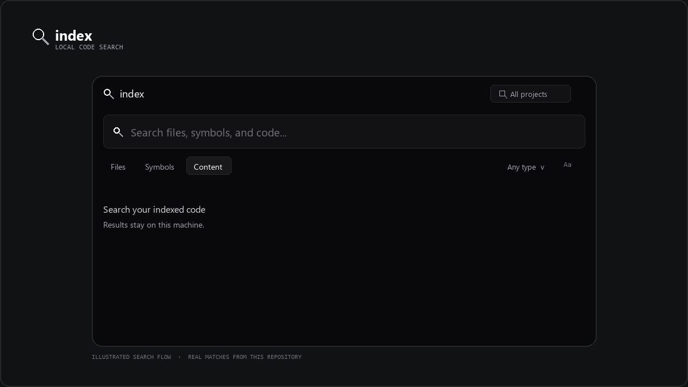
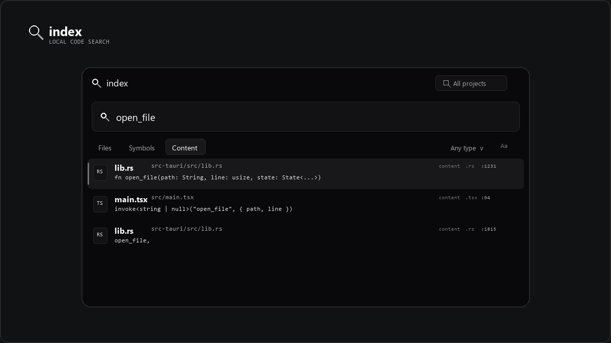

<div align="center">
  
  <h1>Trace</h1>
  <p>A small, local-first search palette for files, symbols, and code.</p>
  <p>
    <a href="https://github.com/333sematary/index-local-code-search/releases/latest">Download for Windows</a>
    ·
    <a href="https://github.com/333sematary/index-local-code-search/releases">Releases</a>
    ·
    <a href="#development">Build from source</a>
  </p>
</div>

<p align="center">
  
</p>

> The animation is an illustration of the real palette, not a screen recording. Its example matches come from this repository's source.

<p align="center">
  
</p>

## Local code search, one shortcut away

Open Index with the global shortcut, type a filename, symbol, or code fragment, then press **Enter** to open the selected match at its line. Index is a compact Tauri desktop app; your project files stay on your machine.

### What it can search

| Mode | Finds |
| --- | --- |
| **Files** | File names, including fuzzy matches for partial names and small typos. |
| **Symbols** | Functions, types, and other declarations parsed from Rust, TypeScript/TSX, JavaScript/JSX, and Lua. |
| **Content** | Source text and snippets, ranked locally with SQLite FTS5. |

Content results can be combined with an extension or project filter. Search also ranks exact, prefix, subsequence, and small-edit-distance matches to keep short queries useful.

### Built for daily use

- A filesystem watcher updates only changed files and batches nearby events. Refresh scans recover from watcher errors.
- SQLite stores the local index. Content hashes let refresh skip unchanged files.
- `.gitignore`, `.git/info/exclude`, hidden entries, and common generated folders are respected.
- Files larger than 1 MB and files that are not valid UTF-8 are skipped safely.
- Open results in VS Code, Visual Studio, or Neovim at the matching line. Automatic mode checks VS Code first, then Visual Studio; configure an executable in Settings if detection does not find your editor.
- A configurable global shortcut focuses the existing palette instead of creating another window.

### Keyboard

| Shortcut | Action |
| --- | --- |
| `Ctrl+Shift+Space` | Show Index and focus search (default global shortcut). |
| `Ctrl+K` | Focus search. |
| `Ctrl+P` | Choose or add a project folder. |
| `↑` / `↓` | Move through results. |
| `Enter` | Open the selected result at its line. |
| `Esc` | Close a popup or clear the current query. |

## Install

Download the [Windows MSI](https://github.com/333sematary/index-local-code-search/releases/latest/download/Index_0.1.1_x64_en-US.msi) from the latest release and run it. Windows builds use WebView2.

## Development

Prerequisites: Node.js/npm, Rust, and the Tauri 2 platform prerequisites. On Windows, use the MSVC Rust toolchain. For Linux, install GTK and WebKitGTK development packages as described in the [Tauri prerequisites](https://v2.tauri.app/start/prerequisites/).

```sh
npm install
npm run tauri dev
```

Build the frontend or desktop bundle:

```sh
npm run build
npm run tauri build
```

On Windows, Tauri produces an MSI and an NSIS installer under `src-tauri/target/release/bundle/`. Run the backend tests with:

```sh
cargo test --manifest-path src-tauri/Cargo.toml
```

## Local by design

Index does not require an account, contact an indexing service, or upload project contents. It does not edit source files. SQLite data is stored in the operating system's application data directory.

## License and contact

Index is licensed under the [MIT License](LICENSE). Third-party dependencies keep the licenses declared by their respective package and crate metadata.

Built by **3yck** · Discord: `3yck` · [bernardolbrunelli@gmail.com](mailto:333sematary@gmail.com)
